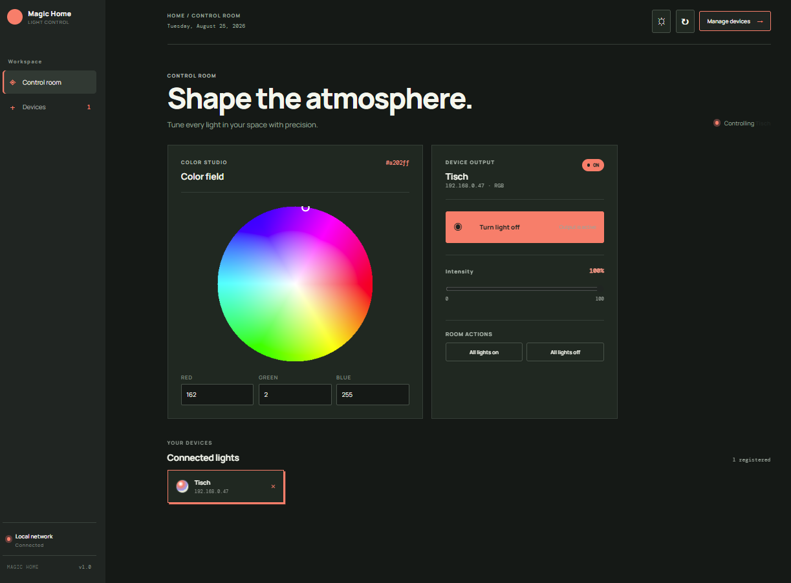
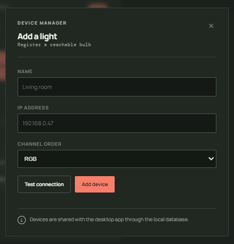
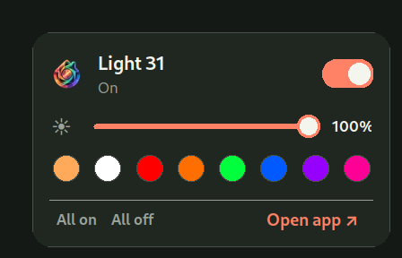
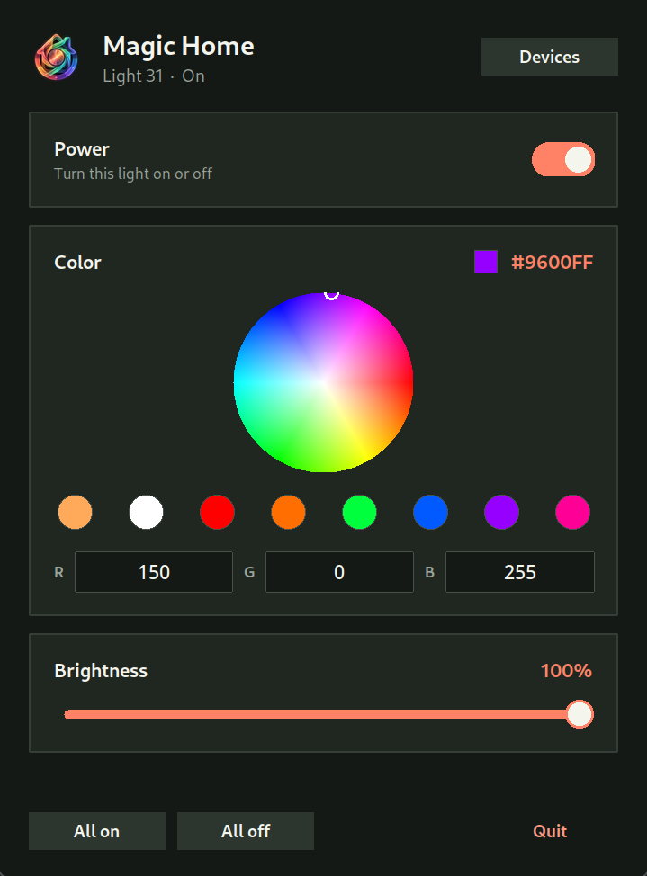
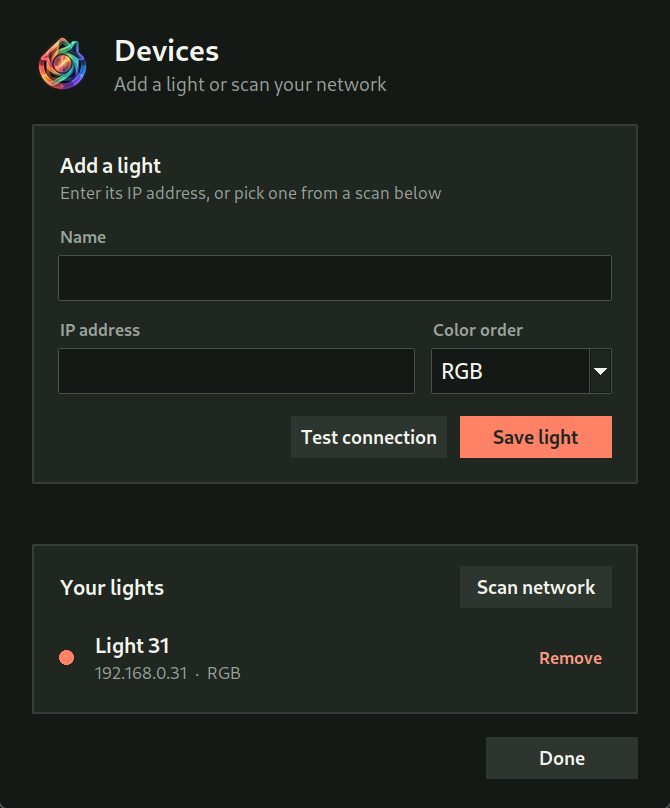

# Magic Home Control

A local smart-light controller for Flux LED bulbs. The project provides a FastAPI backend, an Angular web interface, and a Tkinter desktop app that lives in the system tray.

## Architecture

```text
Angular web app  ->  FastAPI backend  ->  Flux LED bulbs
Tkinter desktop  ->  local desktop client
                         |
                    shared SQLite database
```

The backend is the API boundary for the web application. The desktop client remains available and shares device configuration through the same SQLite database.

## Features

- Modern responsive web control room
- Dark mode by default, with a saved light-mode option
- Accurate HSV color wheel and RGB controls
- Brightness control that can recover after reaching 0%
- Turn one bulb on or off
- Turn all configured bulbs on or off
- Add, test, and remove devices
- Configurable RGB channel order: RGB, GRB, BGR, GBR, RBG, or BRG
- FastAPI interactive documentation
- Desktop app in the system tray: click the icon for a compact quick-control popup, or open the full window
- Network scan that finds bulbs and adds them in a few clicks (web and desktop)
- SQLite device storage

## Screenshots

### Web Application

The web application runs as a modern control room with device controls, a color wheel, brightness control, device management, and dark mode.





### Desktop Application

The desktop app lives in the system tray and uses the same dark design and device database as the web app.

**Quick controls.** Clicking the tray icon opens a compact popup just above the taskbar: power switch, brightness, color presets, All on / All off, and a link to the full app. Clicking anywhere else closes it.



**Main window.** Power switch, color wheel with presets and RGB fields, and a brightness slider you can click or drag.



**Devices.** Add a light by IP address, or scan your network and add the bulbs it finds.



## Requirements

For the Docker setup:

- Docker Desktop with Docker Compose
- Bulbs reachable on the same local network as the Docker host

For the desktop client without Docker:

- Python 3.11 or newer
- Tkinter: included with the standard Python installer on Windows; on Fedora install `python3-tkinter`, on Debian/Ubuntu `python3-tk`
- Linux with KDE Plasma: `python3-gobject` (PyGObject) for the tray icon; it is usually installed already

Install the desktop dependencies in a virtual environment. On Linux, create it with `--system-site-packages` so the app can use the system's Tkinter and PyGObject:

```bash
python3 -m venv --system-site-packages .venv
.venv/bin/pip install pillow pystray flux_led numpy requests
```

On Windows:

```powershell
python -m venv .venv
.venv\Scripts\pip install pillow pystray flux_led numpy requests
```

## Run The Web Application

From the repository root:

```powershell
docker compose up --build
```

Open the applications here:

- Web frontend: http://localhost:8080
- API documentation: http://localhost:8000/docs
- API health check: http://localhost:8000/api/health

Run the services in the background:

```powershell
docker compose up -d --build
```

Useful Docker commands:

```powershell
docker compose ps
docker compose logs -f backend
docker compose logs -f frontend
docker compose down
```

## Run The Desktop Application

The desktop client runs separately from the web frontend and does not need Docker. From the repository root:

```bash
.venv/bin/python -m desktop.app.main        # Linux
.venv\Scripts\python -m desktop.app.main     # Windows
```

The app adds an icon to the system tray:

- **Left-click** the icon: open or close the quick-control popup.
- **Right-click** the icon: menu with Quick controls, Open Magic Home, and Quit.
- **Open app** in the popup (or **Open Magic Home** in the menu) opens the full window. Its **Devices** button opens the device manager.

On KDE Plasma the app talks to the Plasma tray directly, so a left-click opens the popup right at the icon. On other systems (for example Windows) it uses `pystray`, where a left-click opens the quick controls as well.

The desktop application uses the shared SQLite database at `data/devices.db`, so devices added in the web app also appear here and the other way around.

## Device Configuration

Use the web interface's **Manage devices** action to add a bulb. A device must be reachable before it can be saved.

### Scan for devices

Instead of typing an IP address, you can search the local network for Flux LED bulbs:

- **Web:** open **Manage devices** and click **Scan network**. Click **Use** next to a bulb to fill in the form, pick the channel order, then click **Add device**.
- **Desktop:** open the full app, click **Devices**, then **Scan network** in the *Your lights* card. Bulbs that are not saved yet appear with an **Add** button that fills in the form; rename the light if you like, pick the color order and click **Save light**.

The scan sends a UDP broadcast, so the backend container runs with `network_mode: host` in `compose.yaml` (supported on Linux). The API is still served on port 8000 and the frontend reaches it through the Docker host gateway.


After the first backend start, active device data is stored in:

```text
data/devices.db
```

The API returns HTTP 504 when a registered or new device is unreachable. Docker must have access to the local network, and the bulb must be powered on.

## API Overview

| Method | Endpoint | Purpose |
| --- | --- | --- |
| GET | `/api/devices` | List devices |
| POST | `/api/devices` | Test and add a device |
| POST | `/api/devices/check` | Check an IP address |
| DELETE | `/api/devices/{ip}` | Remove a device |
| GET | `/api/devices/{ip}/state` | Read power, color, and brightness |
| POST | `/api/devices/{ip}/on` | Turn one device on |
| POST | `/api/devices/{ip}/off` | Turn one device off |
| POST | `/api/devices/all/on` | Turn all devices on |
| POST | `/api/devices/all/off` | Turn all devices off |
| PUT | `/api/devices/{ip}/color` | Set RGB color |
| PUT | `/api/devices/{ip}/brightness` | Set brightness from 0 to 100 |

## Project Structure

```text
Magic-Home-Control/
├── backend/
│   ├── app/
│   │   ├── main.py              FastAPI routes
│   │   ├── bulb_service.py      Flux bulb operations
│   │   ├── repository.py        SQLite persistence
│   │   ├── models.py            API models
│   │   └── tests/               Backend tests
│   └── Dockerfile
├── frontend/
│   ├── src/app/                 Angular application
│   ├── Dockerfile
│   └── nginx.conf
├── desktop/
│   ├── app/                     Tkinter and tray client
│   │   ├── main.py              Entry point: tray icon and window handling
│   │   ├── kde_tray.py          KDE Plasma tray icon (left-click popup, right-click menu)
│   │   ├── quick_panel.py       Quick-control popup
│   │   ├── mainWindow.py        Main window
│   │   ├── DeviceManager.py     Device manager window
│   │   ├── widgets.py           Shared controls: switch, slider, color presets
│   │   ├── theme.py             Colors, styles and app icon
│   │   └── device_repository.py SQLite persistence adapter
│   ├── assets/                  App icon
│   └── tests/                   Desktop tests
├── docs/screenshots/            README screenshots
├── data/
│   ├── devices.csv              Migration seed file
│   └── devices.db               Runtime SQLite database
├── compose.yaml
└── README.md
```

## Testing

Run the desktop and migration tests from the repository root:

```powershell
python -m pytest desktop/tests -q
```

Validate the Python source:

```powershell
python -m compileall -q backend desktop
```

## Security

This application is intended for a trusted local network. Do not expose the API directly to the internet. Add authentication, HTTPS, and stronger network controls before remote access.

## License

This project is licensed under the MIT License. See `LICENSE`.
